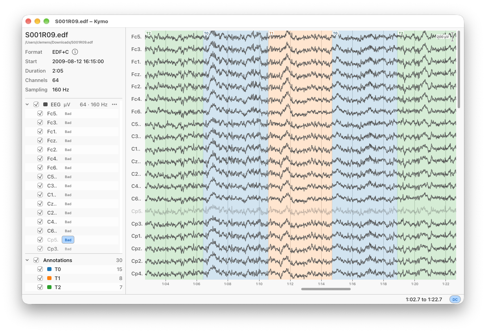

# Kymo

Kymo is a cross-platform, highly optimized, blazingly fast viewer for EEG and MEG recordings. It opens huge recordings almost instantly and supports smooth scrolling and zooming while using very little memory, regardless of file size.



Kymo is named after the kymograph, a rotating drum used to record physiological signals in the 19th century.

> Kymo is under active development. It runs as a standalone viewer on macOS, Windows, and Linux; integration with [MNE-Python](https://mne.tools) and [MNELAB](https://github.com/cbrnr/mnelab) is planned (see the [roadmap](#roadmap)).

## Why Kymo?

- **Recordings open almost instantly.** The first view appears in under a second while Kymo builds an overview of the entire recording in the background. It caches this overview, so subsequent openings are even faster.
- **Scrolling and zooming stay smooth.** Kymo maintains 60 frames per second or more, whether displaying just a few samples or an entire recording. If some data is not ready yet, it shows a coarser version until the detail is available.
- **Memory use stays low.** Kymo reads only the data needed for the current view, keeping memory use low even for recordings with tens of gigabytes of data.
- **Every peak remains visible.** Each pixel represents the minimum and maximum of all samples it covers, ensuring that spikes and artifacts remain visible even when zoomed out.
- **Rendering uses the GPU.** Kymo uses Metal, Vulkan, or DirectX 12 to accelerate rendering, keeping the interface responsive even with large recordings and many channels.

### Benchmarks

The following table compares Kymo with [MNE-Qt-Browser](https://github.com/mne-tools/mne-qt-browser), the default browser in MNE-Python. All measurements were taken on the same MacBook Pro with an M2 Pro chip and 32 GB of RAM.

| Recording | Viewer | Frame time while scrolling (p99) | Zoom out to the whole recording | Peak memory |
| --- | --- | --- | --- | --- |
| 64 channels, 1 h, EDF | **Kymo** | **10 ms** | **8 ms per step** | **125 MB** |
| | MNE-Qt-Browser | 16 ms to 2.5 s | 2.8 s per step | 7.7 GB |
| 306 channels, 1 h, EDF | **Kymo** | **9 ms** | **8 ms per step** | **158 MB** |
| | MNE-Qt-Browser | 22 ms to 4.3 s | 4.6 s per step | 13.9 GB |
| 256 channels, 8 h, BDF (45 GB) | **Kymo** | **11 ms** | **31 ms per step** | **280 MB** |
| | MNE-Qt-Browser | did not finish | stopped after 10 min | 67.6 GB |

The benchmarks reflect files that have been opened previously. On first opening, scrolling is just as fast, but the zoomed-out view gradually fills in as Kymo builds the overview.

## Features

The following sections show keyboard shortcuts for macOS. On Windows and Linux, <kbd>Ctrl</kbd> replaces <kbd>⌘</kbd>, <kbd>Alt</kbd> replaces <kbd>⌥</kbd>, and <kbd>Shift</kbd> replaces <kbd>⇧</kbd>.

### Supported file formats

| Format | Files |
| --- | --- |
| EDF, EDF+, BDF, BDF+ (continuous and discontinuous) | `.edf`, `.bdf` |
| BV (BrainVision) | `.vhdr` with `.eeg` and `.vmrk` |
| BVRF (BrainVision Recording Format) | `.bvrh` with `.bvrd` and `.bvrm` |
| EEGLAB | `.set`, with or without `.fdt` |
| FIFF (Neuromag/MEGIN) | `.fif` |
| GDF | `.gdf` |
| XDF | `.xdf` |

- Kymo identifies the format from the file contents instead of the extension. Opening any file of a recording set (for example, a BrainVision `.eeg` file) opens the entire recording.
- Channels can have different sampling rates. Gaps in a recording are shown as empty space.
- XDF streams are synchronized and dejittered as in [PyXDF](https://github.com/xdf-modules/pyxdf). Marker streams are shown as annotations.
- BVRF recordings with multiple participants group each participant's channels and markers separately.
- All readers are checked against [MNE-Python](https://mne.tools), [PyXDF](https://github.com/xdf-modules/pyxdf), and [PyBVRF](https://github.com/cbrnr/pybvrf).
- Kymo never modifies the recording files.

### Navigation

- Scroll and zoom with the trackpad, mouse wheel, or keyboard. Jump to the beginning or end, go to a specific time, or fit the entire recording on the screen.
- Move through the channels and choose how many to display at once.
- Hover over a trace to see its value at that point.
- Open recordings from the file manager (**Open With**, or a double-click once Kymo is the default app for a file type), the command line, the **File** menu, the recent files list, or by dragging them onto the window (currently not supported on Linux using Wayland). Opening a recording while another one is open replaces it, after asking about unsaved annotations.
- **View → Show Minimap** adds a strip below the traces, in place of the time scrollbar, that shows the whole recording: its annotations, a row per channel that shows where the signal is large (bright), flat (dark), or missing (empty), and the part on screen. Click or drag it to move there, drag its top edge to make it taller, and right-click it to hide the channel rows (also in **Settings → Minimap**).
- **File → Recording Info** shows the recording's header fields, start time, duration, sampling rates, streams, and channel groups.

### Channels and scaling

- The sidebar lists channels grouped by type (and by stream or participant for XDF and BVRF). It supports collapsing groups and showing or hiding individual channels or entire groups.
- Select channels as in any list (click, <kbd>⌘</kbd>-click, or <kbd>⇧</kbd>-click), all of them with <kbd>⌘A</kbd>, or a type's channels from its menu. While channels are selected, a bar below the list marks, retypes, or scales them at once.
- Mark a channel as bad (or good again) by clicking its name next to the traces, or from the menu at the end of its row in the sidebar, where bad channels say **Bad**. Bad marks can be undone. Channels the recording already marks as bad are recognized.
- Channel types are names, not a fixed list. Kymo recognizes common types (including those of MNE-Python, BIDS, and EDF+) and keeps any other type names found in the recording.
- Change the type of a channel from the menu at the end of its row, or of the selected channels from the bar below the list: choose an existing type, enter a new name, or select **From File** to restore the types stored in the recording.
- Each channel type has its own color, DC removal, and scale, set in the sidebar or in the **Channel Types** window. Kymo remembers these settings by type name across recordings.
- Save and load channel types and bad channels to/from a [BIDS](https://bids.neuroimaging.io) `channels.tsv` file.
- Channels of the same type and unit share an amplitude scale. Use **Auto Scale** to fit the scales to the current view, or set them manually. Scale bars and values use a suitable unit (for example, 2 mV instead of 2000 µV).
- Scale a single channel by <kbd>⌥⇧⌘</kbd>-scrolling or -pinching over its trace, or the selected channels with <kbd>⌥⇧⌘+</kbd> and <kbd>⌥⇧⌘−</kbd>. A ↕ next to the channel name marks it; click it to return to the type's scale.
- DC removal keeps channels with large offsets centered in their rows. It is applied only to types whose absolute level is not meaningful, so temperature or oxygen saturation, for example, keep their levels.

### Measuring

- Hold <kbd>⇧</kbd> and drag across the traces to measure between two points. The label shows the time difference, the corresponding frequency, and the peak-to-peak amplitude of the channel in between, accurate at any zoom level.
- The status line shows both endpoints' times and values and the number of samples between them.

### Annotations and events

- Annotations from a recording appear as colored bands and lines. Use the legend to show, hide, or recolor them by description.
- Kymo detects events in trigger (stim) channels.
- In annotation editing mode, drag to create an annotation, then move, resize, rename, merge, or delete it, with undo and redo.
- Save annotations as a BIDS events file (`.tsv`), or load them from one or from an MNE-Python annotations CSV file.

### Look and feel

- Choose a light or dark theme, or follow the system setting; selections take the system's accent color.
- Choose custom colors for channel types and annotations.
- Kymo uses native menus and standard keyboard shortcuts on each platform; **Help → Keyboard Shortcuts** lists them all.
- Settings are saved between sessions.
- **Settings → Disk Cache** limits how much disk space the cached overviews take (5 GB by default, or **Unlimited**): beyond it, those of the recordings used longest ago are removed. **Session** keeps them only until Kymo quits. **Off** writes nothing to disk, for recordings that shouldn't leave traces on the computer: overviews are kept in memory instead, which then grows with the recording (about a tenth of its size; Settings shows how much for the open one). It also shows how much space they take, and **Clear** removes them (they are rebuilt when a recording is opened again; settings stay).
- At startup, at most once a day, Kymo asks GitHub whether a newer release is out and offers to open its download page. Turn this off in **Settings → Updates**; **Check for Updates…** (in the **Kymo** menu on macOS, the **Help** menu elsewhere) asks right away.

## Installation

Download Kymo for your platform from the [Releases](https://github.com/cbrnr/kymo/releases) page. Kymo needs a graphics driver that supports Metal (macOS), DirectX 12 or Vulkan (Windows), or Vulkan (Linux).

### macOS

Kymo runs on Macs with Apple silicon and macOS 11 or later. Open `Kymo-<version>-macos-arm64.dmg` and drag **Kymo** to **Applications**. The app is signed and notarized, so it opens without warnings.

### Windows

Kymo runs on 64-bit Windows 10 and 11. Run `Kymo-<version>-windows-x86_64.exe`. By default, Kymo is installed for the current user only, which needs no administrator rights. Optionally, the installer creates a desktop shortcut and adds Kymo to `PATH`. Kymo appears under **Open With** for the recordings it reads, without becoming their default app.

The installer is not signed yet, so Microsoft Defender SmartScreen may warn about it the first time. Click **More info**, then **Run anyway**.

Uninstall Kymo from **Settings → Apps**. The uninstaller asks whether to also remove Kymo's settings and its cache of recording overviews (they are kept unless you choose to remove them).

### Linux

On Arch Linux and its derivatives, install the [`kymo-bin`](https://aur.archlinux.org/packages/kymo-bin) package from the AUR, which installs the prebuilt binary of a release (x86_64 and aarch64), for example with `yay -S kymo-bin` or `paru -S kymo-bin`. The [`kymo`](https://aur.archlinux.org/packages/kymo) package builds it from source instead.

On NixOS or with Nix, there is an unofficial [Nix flake](https://github.com/DerAndereJohannes/kymo-nix).

On other distributions, download `kymo-<version>-linux-x86_64.tar.gz` (or `-linux-arm64.tar.gz`), extract it, and run the included install script:

```sh
tar xzf kymo-<version>-linux-x86_64.tar.gz
cd kymo-<version>-linux-x86_64
./install.sh
```

This installs Kymo for the current user (no root needed): the executable in `~/.local/bin`, and a launcher entry, icons, and file types for recordings in `~/.local/share`, so file managers offer Kymo under **Open With**. `./install.sh --uninstall` removes them again. The executable needs glibc 2.35 or later (Ubuntu 22.04, Debian 12, Fedora 36, or newer) and runs on Wayland and X11.

### Building from source

Building Kymo requires [Rust](https://rustup.rs) 1.95 or later and a C compiler. See [CONTRIBUTING.md](CONTRIBUTING.md) for platform-specific setup instructions.

```sh
git clone https://github.com/cbrnr/kymo.git
cd kymo
cargo build --release -p kymo
```

The executable is available at `target/release/kymo` (`kymo.exe` on Windows).

## Usage

```sh
kymo recording.bdf          # open a recording
kymo                        # choose a file in a dialog
kymo --info recording.fif   # print a recording summary without opening a window
```

On Linux, `kymo` works in a terminal if `~/.local/bin` is on your `PATH` (the install script tells you if it isn't). On Windows, it works if you chose **Add Kymo to PATH** during installation; since Kymo is a windowed program there, the terminal doesn't wait for it, so text it prints (such as `kymo --info`) appears after the next prompt (press Enter to get a fresh one).

On macOS, link the executable inside the app bundle to a folder on your `PATH`, for example `/usr/local/bin` (needs your password):

```sh
sudo mkdir -p /usr/local/bin
sudo ln -s /Applications/Kymo.app/Contents/MacOS/kymo /usr/local/bin/kymo
```

Or, without `sudo`, link it to `~/.local/bin` and add that folder to your `PATH`:

```sh
mkdir -p ~/.local/bin
ln -s /Applications/Kymo.app/Contents/MacOS/kymo ~/.local/bin/kymo
echo 'export PATH="$HOME/.local/bin:$PATH"' >> ~/.zprofile   # then open a new terminal
```

## Roadmap

- **Display filters:** High-pass and low-pass filters, similar to those in MNE-Python's `raw.plot()`.
- **Python package:** Install with `pip install kymo` and use `kymo.plot(raw)` to view any MNE-Python `Raw` object, with bad channels and annotations passed back to Python.
- **MNE-Python backend:** Open Kymo directly from `raw.plot()`.
- **MNELAB:** Use Kymo as the signal viewer in MNELAB.
- **More:** Additional file formats, re-referencing, and names for event codes.

## Contributing

Contributions are welcome! [CONTRIBUTING.md](CONTRIBUTING.md) explains how to set up your development environment, build Kymo, and run the checks, and gives an overview of the architecture.

## License

Kymo is licensed under the [BSD 3-Clause License](LICENSE).
